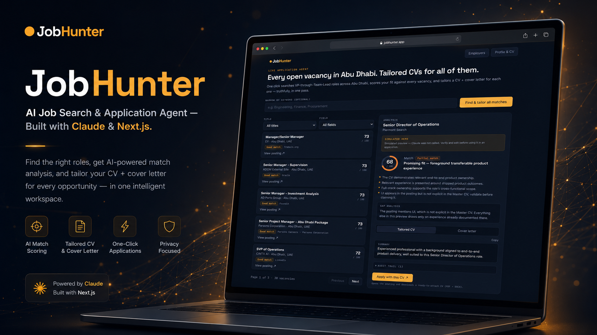

# JobHunter: AI Job Search & CV Tailoring Agent

JobHunter is an **AI job-hunting agent** built with **Next.js, TypeScript and Claude AI**. One click searches executive, managerial, government and senior-specialist roles in Abu Dhabi across ~40 employer career sites and LinkedIn. It then writes a **tailored CV and cover letter** for the single job you choose to apply to.

**Live app:** [jobhunter-lemon.vercel.app](https://jobhunter-lemon.vercel.app) <sub>(password-protected because it holds private CV data)</sub>

## ✨ Features

- **Career-site search, no paid job API.** Reads the public job feeds behind ~40 Abu Dhabi employers' career pages (Oracle Recruiting Cloud, Workday, SmartRecruiters, Lever, Phenom, Workable, Eightfold, SuccessFactors). Only real management titles in Abu Dhabi, posted in the past 30 days, with a full description are kept.
- **LinkedIn-only mode.** Uses TheirStack to fetch LinkedIn vacancies posted in Abu Dhabi, with a durable 12-hour cooldown and incremental syncs to protect paid credits.
- **One-click CV tailoring with Claude.** Returns a tailored profile, rewritten experience bullets, a cover letter, a short gap analysis and an audit trail that shows which master-CV statement backs each claim.
- **Truthful by design.** Claude only re-orders, re-emphasizes and rephrases what is already in your master CV. It never invents experience; gaps are called out instead.
- **Ready-to-send documents.** "Apply with this CV" downloads the finished CV and cover letter (PDF and/or DOCX), then opens the original posting.
- **Profile import.** Upload an existing CV (.pdf/.docx, including LinkedIn's "Save to PDF") and Claude extracts it into your profile, including an embedded photo.
- **Secure by default.** API keys stay server-side, the site is password-gated and login attempts are throttled.

## 🛠 Tech Stack

`Next.js 14 (App Router)` `TypeScript` `React 18` `Tailwind CSS` `Claude API` `Vercel Blob` `@react-pdf/renderer` `docx` `Vitest` `Playwright`

## ⚙️ How it works

```text
Refresh listings
   |
   +-- Career-site feeds (~40 employers)  +-- TheirStack (LinkedIn only)
   |
   +-- Filter: Abu Dhabi + management title + last 30 days + full description
   +-- Deduplicate, rank (government first, then employer tier, recommendation, recency)
   +-- Save to private Vercel Blob storage

"Tailor CV for this job"
   |
   +-- One Claude pass on the full job description (+ optional bounded role research)
   +-- Tailored CV, cover letter, gap analysis and audit trail
   +-- Download PDF / DOCX and open the original posting
```

## 🚀 Run locally

```bash
npm install
cp .env.example .env.local   # add your keys (see below)
npm run dev                  # http://localhost:3000
npm test                     # Vitest suite
```

<details>
<summary><b>Environment variables</b></summary>

| Variable | Needed? | What it's for |
|---|---|---|
| `ANTHROPIC_API_KEY` | Required for production tailoring | Per-job CV/cover-letter generation and CV-upload extraction. Get it at console.anthropic.com. |
| `THEIRSTACK_API_KEY` | Required for LinkedIn mode | Powers LinkedIn-only listings through TheirStack. |
| `BLOB_READ_WRITE_TOKEN` | Required for durable production data | Private durable storage for profiles, saved listings, and TheirStack's restart-safe request guard. Career-site listings run memory-only locally without it; TheirStack still requires Blob. |
| `ANTHROPIC_MODEL` | Optional | Defaults to `claude-sonnet-5`. |
| `ROLE_RESEARCH_ENABLED` | Optional | Bounded role research is enabled by default. Set to `false` to use the complete job description only. |
| `ROLE_RESEARCH_CACHE_DAYS` | Optional | Role-research cache lifetime. Defaults to `45` and is clamped to `30`-`60` days. |
| `FREE_JOBS_MAX_AGE_DAYS` | Optional | Maximum age of a career-site posting. Defaults to `30`, capped at `120`. |
| `FREE_JOBS_TITLE_MODE` | Optional | `tight` (default) keeps real management titles only; `broad` also accepts the title list's generic Senior Specialist/Engineer/Officer fallbacks. |
| `FREE_JOBS_SYNC_DEADLINE_SECONDS` | Optional | Time budget for one refresh. Defaults to `50` on Vercel (its route limit is 60s) and `150` elsewhere. |
| `THEIRSTACK_MAX_RESULTS` | Optional | Maximum LinkedIn records returned by an eligible live sync (`25`-`250`). Defaults to `150`. |
| `SITE_PASSWORD` | Required for a public deployment | Password-gates the site so public/bot traffic cannot access private CV data or burn paid API usage. Use a strong unique value. |
| `DEMO_MODE` | Optional | Set to `true` to block all real Claude/TheirStack calls and use sample data — useful for local dev. Leave unset in production. |

</details>

<details>
<summary><b>Jobs cache and paid-call limits</b></summary>

- The server keeps each provider's successful snapshot in memory and private Blob storage. Normal searches reuse saved data.
- Career-site listings refresh themselves when the saved list is over 6 hours old, and otherwise only when you click **Refresh listings** (at most once every 5 minutes). A site that cannot be reached keeps its saved listings, and the stalest sites are synced first.
- TheirStack live syncs are limited to once every 12 hours and return only newly discovered records where possible. Live refreshes are refused when Blob storage is not configured, so a server restart cannot bypass the paid-request cooldown.
- Saved jobs are never removed automatically. **Clear saved listings** (Profile & CV) requires an exact `Confirm` entry and does not clear either provider's request guard.
- The Recommended marker/filter and employer-priority ordering are local; they never contact a job provider or Claude. The UI intentionally avoids a percentage score that could underestimate the candidate or imply a guaranteed outcome.
- Tailoring treats the complete vacancy description as its primary source. On a role-research cache miss it may make at most one bounded web search during the primary Claude pass; the result is cached by normalized role and functional domain for 30-60 days. Any corrective pass is job-description-only.
- Only "Tailor CV for this job" and CV-upload extraction use paid Claude calls. An explicitly enabled `DEMO_MODE=true` provides labelled sample data; production never silently substitutes fabricated jobs for a missing key.

</details>

<details>
<summary><b>How search works</b></summary>

The shared title taxonomy covers hundreds of executive, managerial, government, oil-and-gas, technical-leadership and senior-professional title variants, including abbreviations and reversed word orders such as `Head of X`, `X Head`, `X Director`, `X Manager` and `X Lead`. See [lib/targetRoles.ts](lib/targetRoles.ts).

Career-site jobs are matched against this list and tightened to real management titles (see `FREE_JOBS_TITLE_MODE`), using the rules in `lib/freeJobs/criteria.ts`. Employers are listed in `lib/freeJobs/sources.ts`; add one by finding its platform from a job's apply URL and confirming it returns jobs.

TheirStack reserves most of each paid sync for executive, government, director and explicitly senior roles before using the remaining capacity for broad manager/lead discovery. Every record is checked again for Abu Dhabi and a matching managerial title, deduplicated and merged into saved listing history.

The **Employers** page shows a curated, static Abu Dhabi employer directory (`lib/employerDirectory.ts`), grouped by sector, with a LinkedIn jobs link for each.

</details>

<details>
<summary><b>Deploy to Vercel</b></summary>

1. Import the repo in Vercel (**New Project**).
2. Add the environment variables above under **Settings → Environment Variables**. Set `SITE_PASSWORD` for any public deployment.
3. Deploy.

</details>

<details>
<summary><b>Project notes</b></summary>

- Keys stay server-side in the API routes and are never exposed to the browser.
- Edit the Profile and Master CV in the app via **Profile & CV**, or change the defaults in `lib/profile.ts` / `lib/masterCV.ts`. The Master CV is generated from the Profile, so the two can't drift apart.
- `@react-pdf/renderer` and `docx` generate the PDF/DOCX files client-side (lazy-loaded on click, not in the main bundle). `pdf-parse` and `mammoth` extract text and, best-effort, an embedded photo from uploaded CVs server-side.

</details>

## 👋 Built by

**Muhammad Mustafa**, Senior Full-Stack SaaS & AI Developer with 10+ years of experience. I build AI agents, SaaS products and full-stack web apps with React, Next.js, Node.js and TypeScript for startups and businesses in the UAE and worldwide.

**Need an AI agent or SaaS product like this?** [aisaaswithmustafa.com](https://aisaaswithmustafa.com/) · [LinkedIn](https://www.linkedin.com/in/muhammad-mustafa-16477a99/) · [Email](mailto:mustufa50@gmail.com)
